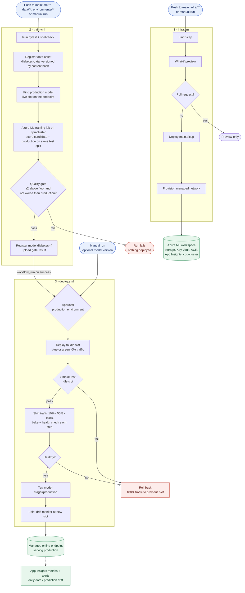

# MLOps on Azure (Azure ML + GitHub Actions)

An end-to-end MLOps template. It trains a scikit-learn model that predicts diabetes progression,
and automates everything around it with GitHub Actions and Azure Machine Learning:

- **Infrastructure as code:** Bicep for the Azure ML workspace, storage, Key Vault, container
  registry, monitoring, managed VNet and optional private endpoints.
- **Versioned data:** the training data is an Azure ML data asset, versioned by content hash.
- **Quality gate:** each new model is scored against the model in production on the same test
  data. Only models that are at least as good are registered.
- **Continuous, safe deployment:** a blue/green rollout to a managed online endpoint, with
  gradual traffic shifting and automatic rollback.
- **Monitoring:** request metrics and alerts in App Insights, plus daily data and prediction
  drift checks.
- **No stored passwords:** GitHub signs in to Azure with OIDC federation.

## Pipeline



## Repository layout

```
.
├── .github/
│   └── workflows/
│       ├── infra.yml              # Bicep lint + what-if on PR; deploy infra on main
│       ├── train.yml              # Tests → register data → train job → quality gate
│       └── deploy.yml             # Blue/green rollout with automatic rollback
├── data/
│   └── diabetes/
│       ├── diabetes.csv           # Training data (10 features + target)
│       └── MLTable                # Makes the folder an Azure ML MLTable data asset
├── environments/
│   ├── conda.yml                  # Training environment
│   └── score.yml                  # Inference environment (same pinned versions)
├── infra/
│   ├── main.bicep                 # Workspace, storage, Key Vault, ACR, monitoring, networking
│   └── main.bicepparam            # Parameters, read from GitHub repo variables
├── mlops/
│   └── azureml/
│       ├── data.yml               # Data asset `diabetes-data`
│       ├── train-job.yml          # Training command job on `cpu-cluster`
│       ├── endpoint.yml           # Managed online endpoint
│       ├── deployment.yml         # Blue/green deployment (App Insights + data collection)
│       ├── monitor.yml            # Daily data + prediction drift monitor
│       └── sample-request.json    # Example scoring request (smoke tests, docs)
├── scripts/
│   ├── setup.sh                   # One-time bootstrap (bash): RG, identity, OIDC, GitHub config
│   ├── setup.ps1                  # Same, for PowerShell
│   └── endpoint_state.sh          # Reports the live slot (blue/green) and model version
├── src/
│   ├── train.py                   # Train, compare with production, quality gate, register
│   └── score.py                   # Endpoint scoring; collects inputs/predictions for drift
├── tests/
│   ├── test_train.py              # Data checks, gate logic, end-to-end training run
│   └── test_score.py              # Scoring + bad-request handling
├── .gitattributes                 # Line endings (LF for .sh/.py/.yml)
├── .gitignore
├── pytest.ini
├── requirements-dev.txt           # Local / CI test dependencies
└── README.md
```

Generated locally and not committed: `venv/`, `mlruns/` (local MLflow store) and `outputs/`
(gate result from local training runs).

---

## Run it end to end

### 1. Prerequisites

| Need | Why |
|---|---|
| An Azure subscription where you are **Owner**, or **Contributor + User Access Administrator** | Setup creates a role assignment |
| Permission to create **app registrations** in Microsoft Entra ID | Identity GitHub uses to sign in |
| [Azure CLI](https://learn.microsoft.com/cli/azure/install-azure-cli) 2.60 or later | `az login`, setup |
| A GitHub repository for this code, and the [GitHub CLI](https://cli.github.com/) (recommended) | Runs the workflows |
| Python 3.10+ (optional) | Running tests and training locally |
| bash (Linux, macOS, WSL, Git Bash) or PowerShell | Setup script |

### 2. Try it locally (optional, no Azure needed)

```bash
python -m venv venv
source venv/bin/activate            # Windows: venv\Scripts\activate
pip install -r requirements-dev.txt
pytest                              # 15 tests: data checks, quality gate, training, scoring

python src/train.py --data data/diabetes
```

The training run prints the gate result and writes it to `outputs/gate/gate.json`. It also
registers `diabetes-rf` in a local MLflow store (`./mlruns`). To browse runs, run `mlflow ui`.

### 3. Push the code to GitHub

```bash
git remote add origin https://github.com/<owner>/<repo>.git   # if not set yet
git push -u origin main
```

The workflows sign in to Azure only from `main`, from the `production` environment and from pull
requests, so the default branch must be `main`.

### 4. Sign in to Azure

```bash
az login
az account set --subscription "<subscription name or id>"
gh auth login                       # if you use --configure-github below
```

### 5. Bootstrap the identity and GitHub settings

```bash
./scripts/setup.sh --repo <owner>/<repo> --configure-github
```

PowerShell alternative: `./scripts/setup.ps1 -GitHubRepo <owner>/<repo>`

The script creates:

- the resource group `rg-mlops` (`--resource-group`, `--location` to change it);
- the Entra app `sp-mlops-github` with **Contributor** on that resource group;
- federated credentials, so GitHub Actions can sign in without a stored secret;
- with `--configure-github`: the repo secrets (`AZURE_CLIENT_ID`, `AZURE_TENANT_ID`,
  `AZURE_SUBSCRIPTION_ID`), the variables (`AZURE_RESOURCE_GROUP`, `AZURE_ML_WORKSPACE`,
  `ENDPOINT_NAME`) and the `production` environment.

Without `--configure-github`, add the printed values under **Settings → Secrets and variables →
Actions** and create an environment named `production`.

The script is safe to re-run. `./scripts/setup.sh --help` lists all options.

### 6. Choose your options (optional)

Defaults work as they are. To change one, set a repo variable, for example
`gh variable set ALERT_EMAIL --body you@example.com`:

| Variable | Default | Purpose |
|---|---|---|
| `ALERT_EMAIL` | (none) | Email for failed-request / latency alerts. If empty, no alerts are created |
| `GATE_MIN_R2` | `0.3` | Minimum r2 a model must reach |
| `GATE_MIN_DELTA` | `0.0` | Required r2 gain over production. A negative value allows a small regression |
| `TRAFFIC_STEPS` | `10 50 100` | % of traffic sent to the new model at each rollout step |
| `BAKE_SECONDS` | `300` | Wait between rollout steps |
| `AML_ISOLATION_MODE` | `AllowInternetOutbound` | Managed VNet mode (`Disabled`, `AllowInternetOutbound`, `AllowOnlyApprovedOutbound`) |
| `AML_PRIVATE_ENDPOINTS` | `false` | Private endpoints with no public access. See [Private networking](#private-networking) |
| `ENDPOINT_PUBLIC_ACCESS` | `enabled` | Set `disabled` to make the scoring endpoint private |
| `RUNNER_LABEL` | `ubuntu-latest` | Self-hosted runner label (required with private endpoints) |

**Manual approval:** to approve each production rollout by hand, add yourself as a required
reviewer under **Settings → Environments → production**. Remove the reviewer once you trust the
quality gate to get fully continuous delivery.

### 7. Create the Azure resources

```bash
gh workflow run infra
gh run watch                        # takes about 5-10 minutes
```

This creates the workspace, storage, Key Vault, container registry, Log Analytics, App Insights,
the `cpu-cluster` training cluster and the managed network. After this, infra runs on every
push that changes `infra/**`, and pull requests get a what-if preview.

> **Already deployed an older version of this project?** Managed VNet can only be turned on for
> a workspace with no compute. Delete the cluster first
> (`az ml compute delete -n cpu-cluster -g rg-mlops -w mlw-mlops --yes`), or set
> `AML_ISOLATION_MODE=Disabled`.

### 8. Train the model

```bash
gh workflow run train
gh run watch                        # first run takes about 15-20 minutes (builds the environment image)
```

The workflow:

1. runs `pytest` and `shellcheck`;
2. registers `data/diabetes` as `diabetes-data` (the version is a hash of the content);
3. finds the model version that is serving production traffic (none on the first run);
4. runs the training job on `cpu-cluster`, which scores the new model and the production model
   on the same test split;
5. registers the new model only if it passes the gate, and shows the result in the run summary.

A rejected model fails the run, and nothing is deployed. After this first run, train starts
automatically on pushes to `main` that change `src/`, `data/`, `environments/` or the job specs.

### 9. Deploy

`deploy` **starts automatically** after a successful `train` run on `main`. If you set a
required reviewer, approve it in the **Actions** tab. To start it by hand:

```bash
gh workflow run deploy                         # latest version that passed the gate
gh workflow run deploy -f model_version=3      # a specific version
```

The first deployment creates the endpoint and sends 100% of traffic to `blue`. Later
deployments go to the idle slot (`green`/`blue`) at 0% traffic, which is smoke-tested and then
gets 10% → 50% → 100% of traffic, with health checks between steps. If any step fails, traffic
returns to the previous slot automatically. After a successful rollout, deploy tags the model
`stage=production` and points the drift monitor at the new slot.

### 10. Call the endpoint

```bash
ENDPOINT=$(gh variable get ENDPOINT_NAME)
az configure --defaults group=rg-mlops workspace=mlw-mlops

# With the CLI
az ml online-endpoint invoke -n "$ENDPOINT" --request-file mlops/azureml/sample-request.json

# Over HTTPS
URI=$(az ml online-endpoint show -n "$ENDPOINT" --query scoring_uri -o tsv)
KEY=$(az ml online-endpoint get-credentials -n "$ENDPOINT" --query primaryKey -o tsv)
curl -s "$URI" -H "Authorization: Bearer $KEY" -H "Content-Type: application/json" \
     -d @mlops/azureml/sample-request.json
# → [<predicted disease progression>]
```

A request uses the MLflow "split" format in `sample-request.json` and can contain 1-1000 rows.
Malformed requests get HTTP 400.

### 11. Monitor

| What | Where |
|---|---|
| Requests, latency, failures | App Insights `appi-mlops` (alerts go to `ALERT_EMAIL`) |
| Endpoint metrics per deployment | Azure portal → the online endpoint → Metrics |
| Job, compute and deployment logs | Log Analytics `log-mlops` |
| Daily data drift and prediction drift vs. training data | Azure ML studio → **Monitoring** → `diabetes-rf-monitor` |
| Training runs, metrics, gate results | Azure ML studio → **Jobs** → `diabetes-rf` |

To be emailed when drift is detected, add `alert_notification: {emails: [...]}` under
`create_monitor` in `mlops/azureml/monitor.yml`.

### 12. Clean up

```bash
az group delete -n rg-mlops --yes
az ad app delete --id "$(az ad app list --display-name sp-mlops-github --query '[0].appId' -o tsv)"
```

The Key Vault has purge protection, so after deletion it stays soft-deleted for 90 days and its
name stays reserved. To redeploy into a resource group with the same name within that time,
first restore the vault: `az keyvault recover -n <kv-name>`. You can find the name with
`az keyvault list-deleted -o table`. Alternatively, use a different resource group.

---

## Day-to-day operations

```bash
# Retrain on new data: replace data/diabetes/diabetes.csv (same columns), then
git commit -am "Refresh training data" && git push      # train → gate → deploy

# Retrain and allow a small regression (e.g. after a data refresh changes the test split)
gh workflow run train -f min_delta=-0.02

# Roll back instantly (the previous slot stays deployed at 0%)
az ml online-endpoint update -n "$ENDPOINT" --traffic "blue=100 green=0"

# Redeploy the live version
gh workflow run deploy -f model_version=<n> -f force=true
```

**Data in a datastore:** to train on data in a datastore instead of the repo, point `path` in
`mlops/azureml/data.yml` at a datastore folder that contains an `MLTable` file, e.g.
`azureml://datastores/<store>/paths/diabetes/`.

**Cost:** the idle slot keeps one `Standard_DS3_v2` instance running so you can roll back
instantly. Delete it if you don't need that: `az ml online-deployment delete -n <idle-slot> -e "$ENDPOINT" --yes`.
The training cluster scales to zero when idle. The container registry is Premium whenever
network isolation is on.

## Private networking

- **Managed VNet** (on by default) isolates training compute, serverless Spark (used by the drift
  monitor) and online deployments. `AllowOnlyApprovedOutbound` limits outbound traffic to the
  package feeds listed in `infra/main.bicep`. Azure adds a billed managed firewall in that mode.
- **Private endpoints** (`AML_PRIVATE_ENDPOINTS=true`) put the workspace, storage, Key Vault and
  container registry behind private endpoints in `vnet-mlops`, and turn off public access.
  GitHub-hosted runners can't reach the workspace after that. Run a
  [self-hosted runner](https://docs.github.com/actions/hosting-your-own-runners) in the
  `snet-runners` subnet and set `RUNNER_LABEL` to its label. The infra workflow stays on
  GitHub-hosted runners because it only uses the Azure control plane.
